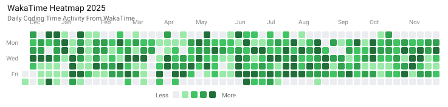

 <h1 align="center">Hi 👋, I'm Ardya Pusaka also A.K.A "Kizaru Zero"</h1>
<h3 align="center">A passionate Fullstack Web Developer From Indonesia</h3>

- 🌱 I’m currently learning **Golang,React and C#**

- 📫 How to reach me **ardyapusaka@gmail.com**

- 📄 Know about my experiences [https://www.linkedin.com/in/ardya-pusaka-74a873303/](https://www.linkedin.com/in/ardya-pusaka-74a873303/)

- ⚡ Fun fact **I Dont Like Coffe**

<h3 align="left">Connect with me:</h3>
<p align="left">
<a href="https://www.linkedin.com/in/ardya-pusaka/" target="blank"></a>
<a href="https://fb.com/ardya" target="blank"></a>
<a href="https://instagram.com/ardyavnx" target="blank"></a>
</p>

<p>&nbsp;</p>

<p></p>

<!--START_SECTION:waka-->


**🐱 My GitHub Data** 

> 📦 735.4 kB Used in GitHub's Storage 
 > 
> 🏆 335 Contributions in the Year 2026
 > 
> 🚫 Not Opted to Hire
 > 
> 📜 39 Public Repositories 
 > 
> 🔑 48 Private Repositories 
 > 
**I'm an Early 🐤** 

```text
🌞 Morning                1524 commits        █████████░░░░░░░░░░░░░░░░   37.02 % 
🌆 Daytime                1690 commits        ██████████░░░░░░░░░░░░░░░   41.05 % 
🌃 Evening                725 commits         ████░░░░░░░░░░░░░░░░░░░░░   17.61 % 
🌙 Night                  178 commits         █░░░░░░░░░░░░░░░░░░░░░░░░   04.32 % 
```
📅 **I'm Most Productive on Friday** 

```text
Monday                   702 commits         ████░░░░░░░░░░░░░░░░░░░░░   17.05 % 
Tuesday                  698 commits         ████░░░░░░░░░░░░░░░░░░░░░   16.95 % 
Wednesday                568 commits         ███░░░░░░░░░░░░░░░░░░░░░░   13.80 % 
Thursday                 696 commits         ████░░░░░░░░░░░░░░░░░░░░░   16.91 % 
Friday                   797 commits         █████░░░░░░░░░░░░░░░░░░░░   19.36 % 
Saturday                 284 commits         ██░░░░░░░░░░░░░░░░░░░░░░░   06.90 % 
Sunday                   372 commits         ██░░░░░░░░░░░░░░░░░░░░░░░   09.04 % 
```


📊 **This Week I Spent My Time On** 

```text
🕑︎ Time Zone: Asia/Jakarta

💬 Programming Languages: 
Python                   2 hrs 13 mins       ███████░░░░░░░░░░░░░░░░░░   26.29 % 
Other                    1 hr 40 mins        █████░░░░░░░░░░░░░░░░░░░░   19.86 % 
C#                       1 hr 26 mins        ████░░░░░░░░░░░░░░░░░░░░░   17.03 % 
Markdown                 1 hr 26 mins        ████░░░░░░░░░░░░░░░░░░░░░   16.97 % 
XML                      34 mins             ██░░░░░░░░░░░░░░░░░░░░░░░   06.77 % 

🔥 Editors: 
Claude Code              5 hrs 20 mins       ████████████████░░░░░░░░░   63.12 % 
VS Code                  2 hrs 53 mins       █████████░░░░░░░░░░░░░░░░   34.09 % 
Visual Studio            14 mins             █░░░░░░░░░░░░░░░░░░░░░░░░   02.79 % 

🐱‍💻 Projects: 
evoq-eprocurement-backend1 hr 52 mins        ██████░░░░░░░░░░░░░░░░░░░   22.20 % 
evoq-eprocurement-backend1 hr 50 mins        █████░░░░░░░░░░░░░░░░░░░░   21.66 % 
cakrawala                1 hr 37 mins        █████░░░░░░░░░░░░░░░░░░░░   19.13 % 
cakrawala_project        1 hr 30 mins        ████░░░░░░░░░░░░░░░░░░░░░   17.85 % 
odoo                     1 hr 14 mins        ████░░░░░░░░░░░░░░░░░░░░░   14.66 % 

💻 Operating System: 
Windows                  8 hrs 28 mins       █████████████████████████   100.00 % 
```

🤖 **AI Coding This Week** 

```text
⏱ AI Coding Time: 6 hrs 13 mins (73.6%)

✍️ 4,310 lines written by AI, 1,219 lines written by hand (77.95% AI-written)

🔤 3,590,523 Input Tokens, 527,606 Output Tokens

💵 $56.22 Estimated AI Cost This Week

🧠 13 AI Sessions, 87 AI Prompts

Fable                    2,646 lines         ███████████████░░░░░░░░░░   61.26 % 
Opus                     1,673 lines         ██████████░░░░░░░░░░░░░░░   38.74 % 

🔎 AI Coding Insights:
🤖 AI-Driven — 77.95% of written lines came from AI
📄 Detailed Prompter — average 1,033 characters per prompt
🔁 Iterative Prompter — average 7 prompts per session
🚀 High AI Trust — 32.65% of changed lines were hand-edited
```


 Last Updated on 23/11/2026 01:10:10 UTC
<!--END_SECTION:waka-->

## WakaTime Yearly Heatmap




